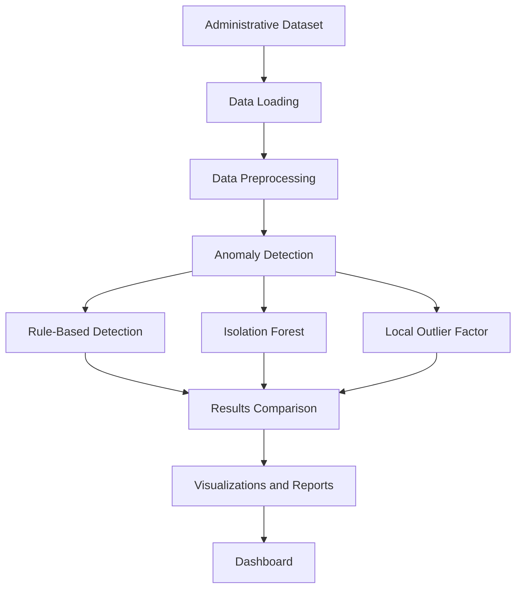

<!-- ═══════════════════════════════════════════════════════════ -->
<!--                    NEXORA AI README                       -->
<!-- ═══════════════════════════════════════════════════════════ -->

<div align="center">


<br/>


<br/>

**An intelligent platform for detecting, analyzing and visualizing anomalies in administrative records.**

<br/>

<a href="YOUR_GITHUB_REPOSITORY_LINK">

</a>


<br/><br/>

</div>

---

<div align="center">

## ◈ THE IDEA BEHIND NEXORA

*Turning complex administrative data into meaningful insights.*

</div>

NEXORA AI is a data-driven anomaly detection application designed to identify unusual patterns and potentially inconsistent information in administrative records.

By combining statistical methods, rule-based detection and unsupervised Machine Learning, the platform helps users investigate suspicious records, compare detection approaches and understand the results through an interactive interface.

<div align="center">

| 500+ | 3 | 2 |
|:---:|:---:|:---:|
| Administrative records | Detection approaches | Machine Learning algorithms |

</div>

---

## ✦ EXPLORE THE PLATFORM

| Module | What it does |
|:---|:---|
|  Dashboard | Overview of the dataset and detection statistics |
|  Administrative Records | Browse and inspect individual dossiers |
|  Anomaly Detection | Identify suspicious records using three approaches |
|  Visualizations | Explore distributions and unusual patterns |
|  Reports | Review analytical results |
|  AI Assistant | Ask questions about detection and evaluation |

---

## ◈ HOW DOES IT WORK?

<div align="center">




## 12. Application Show


</div>

### 01 — Statistical & Rule-Based Detection

Identifies unusual values through predefined logical and statistical rules:

- Invalid age values.
- Requested amounts exceeding five times monthly income.
- Extreme numerical observations using the Interquartile Range (IQR).

### 02 — Isolation Forest

An unsupervised learning algorithm that identifies observations that are easier to isolate from the rest of the dataset.

**Configuration:** 200 estimators · Contamination: 11% · Random state: 42.

### 03 — Local Outlier Factor (LOF)

Detects observations with significantly different local density compared with their neighboring observations.

**Configuration:** 20 neighbors · Contamination: 11%.

### ⚙️ Preprocessing Pipeline

- Missing-value imputation.
- Numerical standardization.
- Categorical encoding.
- Feature transformation using Scikit-learn pipelines.

---

## ◈ DATASET OVERVIEW

The project uses a fictitious dataset of **500 administrative records**, including normal dossiers and artificially introduced anomalies.

**Main variables**

| Category | Variables |
|:---|:---|
| Personal information | `age_demandeur` |
| Financial information | `montant_demande`, `revenu_mensuel` |
| Administrative information | `nb_documents`, `delai_traitement_jours`, `nb_erreurs` |
| Classification | `type_dossier`, `region` |

Ground-truth labels are used to evaluate the detection results against the artificially introduced anomalies.

---

## ◈ PERFORMANCE & MODEL COMPARISON

The detection approaches are evaluated using Accuracy, Precision, Recall and F1-score.

<div align="center">

| Method | Precision | Recall | F1-score | Accuracy |
|:---|---:|---:|---:|---:|
| Rules | 19.23% | 27.27% | 22.56% | 79.40% |
| Isolation Forest | 30.91% | 30.91% | 30.91% | 84.80% |
| LOF | **34.55%** | **34.55%** | **34.55%** | **85.60%** |

</div>

<details>
<summary>✨ What do these results tell us?</summary>

LOF achieved the highest F1-score and Accuracy among the three approaches in this evaluation.

However, anomaly detection remains challenging. False positives and false negatives demonstrate why model predictions must be investigated rather than accepted automatically.

</details>

---

## ◈ A CLOSER LOOK AT AN ANOMALY

**Example: D1007**

| Variable | Value |
|:---|---:|
| Age | -4 |
| Requested amount | 3,199 DT |
| Monthly income | 3,650 DT |
| Number of documents | 5 |
| Processing time | 14 days |
| Number of errors | 3 |

<div align="center">


</div>

**Why was this record flagged?**

The applicant's age is -4, which is logically impossible. The rule-based method identifies this inconsistency through the age validation rule. Isolation Forest and LOF also flag this record as anomalous.

> An unusual observation is not automatically fraud. It is a signal that deserves further investigation.

---

## ◈ TECHNOLOGY STACK

<div align="center">

| Data Science & Backend | Frontend |
|:---:|:---:|
|  |  |
| Pandas · NumPy · Scikit-learn | React · JavaScript · CSS · Vite |

</div>

---

## ◈ PROJECT ARCHITECTURE

The following tree reflects the project folders and files shown in the development workspace.

```text
projet_anomalies/
│
├── __pycache__/
│   └── api.cpython-314.pyc
│
├── .venv/
│   ├── Include/
│   ├── Lib/
│   │   └── site-packages/
│   ├── Scripts/
│   ├── share/
│   ├── pyvenv.cfg
│   └── .gitignore
│
├── data/
│   └── dossiers_administratifs_fictifs.csv
│
├── frontend/
│   ├── node_modules/
│   ├── favicon.svg
│   ├── icons.svg
│   │
│   ├── src/
│   │   ├── assets/
│   │   ├── App.jsx
│   │   ├── App.css
│   │   ├── index.css
│   │   └── main.jsx
│   │
│   ├── .gitignore
│   ├── eslint.config.js
│   ├── index.html
│   ├── package-lock.json
│   ├── package.json
│   ├── README.md
│   └── vite.config.js
│
├── results/
│   ├── figures/
│   ├── comparaison_methodes.csv
│   ├── dossiers_avec_anomalies.csv
│   ├── dossiers_prepares.csv
│   ├── evaluation_finale.csv
│   └── rapport_final.txt
│
├── src/
│   ├── 01_chargement.py
│   ├── 02_pretraitement.py
│   ├── 03_analyse_exploratoire.py
│   ├── 04_detection_anomalies.py
│   ├── 05_visualisation_anomalies.py
│   ├── 06_evaluation_finale.py
│   ├── 07_rapport_final.py
│   ├── 08_verification_finale.py
│   └── 10_application.py
│
├── .env
├── .gitignore
├── api.py
├── README.md
└── requirements.txt
```

---

## ◈ GETTING STARTED

### Prerequisites

- Python 3.10+
- Node.js and npm
- Git

### 1. Clone the repository

```bash
git clone YOUR_GITHUB_REPOSITORY_LINK
cd projet_anomalies
```

### 2. Create a virtual environment

```bash
python -m venv .venv
```

Activate on Windows:

```bash
.venv\Scripts\activate
```

### 3. Install Python dependencies

```bash
pip install -r requirements.txt
```

### 4. Launch the backend

From the project root:

```bash
uvicorn api:app --reload
```

Backend: `http://127.0.0.1:8000`

API documentation: `http://127.0.0.1:8000/docs`

### 5. Launch the frontend

Open a second terminal:

```bash
cd frontend
npm install
npm run dev
```

Open the local address displayed by Vite.

---

## ◈ APPLICATION SHOWCASE

<div align="center">

### A Visual Journey Through NEXORA AI

*Discover the main features of our intelligent anomaly detection platform.*

</div>

| ✦ Dashboard | ◈ Anomaly Detection |
|:---:|:---:|
| Overview of administrative records and key statistics. | Identification of suspicious records using multiple detection methods. |

| ◉ Data Visualizations | ✧ AI Assistant |
|:---:|:---:|
| Interactive charts and statistical insights. | An intelligent assistant answering questions about the project and its results. |

---

<div align="center">

**NEXORA AI — Turning Administrative Data into Meaningful Insights.**

</div>

---

## ◈ PROJECT INFORMATION

<div align="center">

*The minds behind NEXORA AI.*

</div>

| **Project Details** | **Information** |
|:---|:---|
| **Project Name** | NEXORA AI |
| **Academic Subject** | Sujet 13 — Détection des anomalies dans les dossiers administratifs |
| **Institution** | Faculté des Sciences et Techniques (FST), Tunisia |
| **Academic Year** | 2026 |
| **Supervisor** | Mme Imen Ghrisi |
| **Team Members** | Mariem Gharsallah · Zayneb Ben Ali · Loujain Dorrai |

---


## ◈ PROJECT LINKS

<div align="center">

<a href="YOUR_GITHUB_REPOSITORY_LINK">

</a>

<br/><br/>

**Repository URL**

`https://github.com/loujain132/Projet_Anomalies.git`

**Institution:** Faculté des Sciences de Tunis (FST)

**Academic Field:** Mathematics & Computer Science — Data Science

**Project:** Detection of Anomalies in Administrative Records

</div>

---

## ◈ DISCLAIMER

NEXORA AI is an academic project developed using fictitious administrative data.

An anomaly is not necessarily an error or fraudulent activity. The system identifies unusual observations that may require human verification. Its predictions should be interpreted as decision-support indicators, not definitive conclusions.

---

<div align="center">


**NEXORA AI — See Beyond the Data.** ✦

<sub>Academic Project · FST Tunis · 2026</sub>

</div>